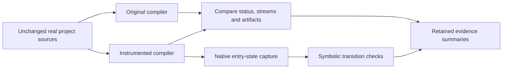

# RGEC

### Recipient-aware compiler caching for AI agents

**Receipt-Gated Epoch Cache (RGEC)** investigates how AI agents could share compiler computation while retaining each recipient's permissions, diagnostics, filesystem effects and failure behavior. The project combines C++ instrumentation of LLVM/Clang, authentic compiler-workload experiments and symbolic analysis of selected native computations.

**Status:** ongoing research. The implemented components and measured results are documented below; a complete security guarantee remains an open research objective.

**Stack:** C++ · Python · LLVM/Clang · angr/VEX · SMT · Modal

## Start here

| Reading goal | Document |
|---|---|
| Understand the problem and proposed contribution | [Project overview](docs/overview.md) |
| Review what was implemented and measured | [Results and interpretation](docs/results.md) |
| Examine experimental controls and comparisons | [Methodology](docs/methodology.md) |
| See current limitations and planned work | [Research roadmap](docs/roadmap.md) |
| Inspect environments and replication requirements | [Reproducibility guide](docs/reproducibility.md) |
| Read the formal candidate and native contracts | [Technical documents](docs/technical/README.md) |

## Work completed

| Component | Recorded evidence |
|---|---|
| Scalar computation-reuse prototype | **19 full zlib builds**, seven C++ compilations and **444 compiler executions** |
| Comparison with native LLVM answers | **64,525 comparisons**, with zero observed mismatches in the tested domain |
| Compiler-call profiling | **606,379 native calls**, with timing calibration and nested-call accounting |
| Sanitizer/coverage intervention | **18 additional full zlib builds**, nine C++ compilations and **423 compiler executions** |
| Native transition analysis | Four TLS-corrected symbolic templates and four conditional address contracts; a later arithmetic phase adds four finite path checks |

These are separate experimental phases, not one combined sample. The results use retained runs from **11 and 22 October 2026**. The scalar cache passed its recorded controls but **did not outperform the capable direct-evaluation baseline**. The later intervention shows that the selected arithmetic family depends strongly on ASan; it is rejected as the main usefulness candidate. [Read the measured results and their limits](docs/results.md).

## Experimental workflow



This diagram shows the evaluation workflow. The complete cache admission, capacity and release controller is still under construction.

## Repository structure

```text
docs/          Project overview, methodology, results and research roadmap
  technical/   Detailed policy and native-contract design notes
code/          Implementation, experiment controllers, workers and tests
evidence/      Selected original audit summaries and a conditional model contract
```

For implementation details, begin at the [code guide](code/README.md). For exact measured-record hashes, use the [evidence index](evidence/README.md). The [publication manifest](PUBLICATION_MANIFEST.json) lists every packaged file.

**Maintainer:** [Pratz1337](https://github.com/Pratz1337)
